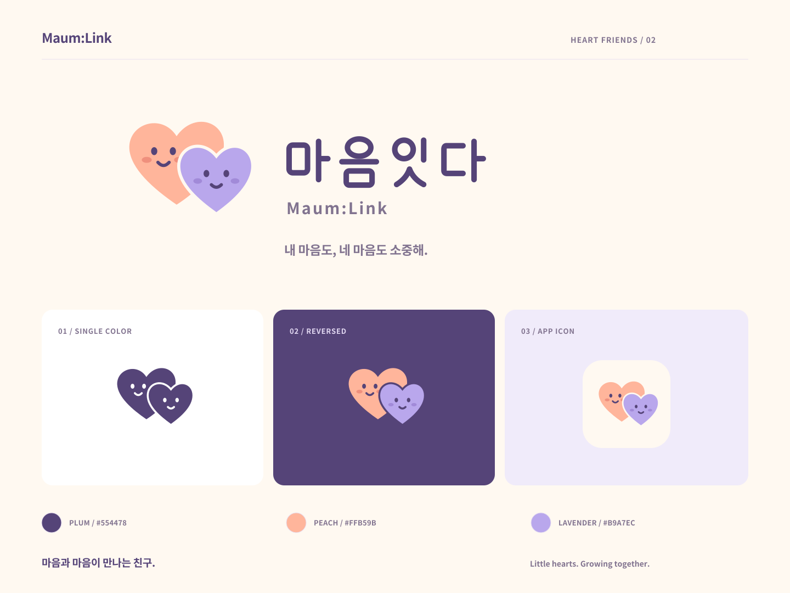

# 마음잇다 / Heart friends

Two little heart friends lean together: peach and lavender, with small smiles and soft cheeks. The custom rounded Korean lettering keeps the brand friendly and readable. This identity is designed for the app's elementary-school audience.



## Files

- **Korean logo:** [SVG](../../public/brand/logo-ko.svg) · [transparent PNG](./logo-ko.png)
- **English logo:** [SVG](../../public/brand/logo-en.svg) · [transparent PNG](./logo-en.png)
- **Bilingual signature:** [SVG](../../public/brand/logo-signature.svg) · [transparent PNG](./logo-signature.png)
- **Heart friends symbol:** [SVG](../../public/brand/symbol.svg) · [transparent PNG](./symbol.png)
- **Monochrome on white:** [logo](../../public/brand/logo-ko-mono.svg) · [symbol](../../public/brand/symbol-mono.svg)
- **Dark backgrounds:** [logo](../../public/brand/logo-ko-reverse.svg) · [symbol](../../public/brand/symbol-reverse.svg)
- **White silhouette with plum facial details:** [symbol](../../public/brand/symbol-white.svg)
- **Presentation:** [SVG](./logo-presentation.svg) · [PNG](./logo-presentation.png)

English and bilingual logos also include monochrome and reversed versions. PNG wordmarks are 2400 pixels wide; the symbol is 1024 pixels square. All use transparent backgrounds. SVGs contain vector artwork and require no installed fonts.

## Palette

| Role | Color |
| --- | --- |
| Lettering and facial features | Plum `#554478` |
| Big heart friend | Peach `#FFB59B` |
| Little heart friend | Lavender `#B9A7EC` |
| App icon background | Warm cream `#FFF9F1` |

Pastels are illustration colors, not small-text colors. Keep faces and wordmarks dark on light backgrounds. On dark backgrounds, use the reversed wordmark with white lettering; the heart friends keep their original colors.

## Use

- Use the Korean logo in the Korean app and the English logo in English mode.
- Use the bilingual signature for large presentation placements; use the symbol alone for app icons.
- Leave approximately one eye-to-eye distance around the artwork. Do not stretch, rotate, add shadows, or change the facial expressions.
- Recommended minimum widths: symbol 32 px; Korean logo 144 px; bilingual signature 260 px. Small browser icons are the exception: their silhouette and colors carry recognition.
- Keep the two characters together. Their smiles are a fixed brand expression, never a signal that a child's feeling is correct or incorrect.
- The installed icon uses an opaque cream tile with artwork inside the maskable safe circle; the OS supplies its outer shape.
- Standalone logos have the accessible name `마음잇다` or `Maum:Link`. Decorative marks beside named controls remain hidden from assistive technology.

## Source

`public/brand/symbol.svg` is the editable vector master. Korean lettering is drawn from rounded geometric strokes in `scripts/build-brand.py`; English and supporting type use the project's local Noto Sans KR 700 (SIL Open Font License), converted to paths. Both can be scaled without loss of quality.

```sh
pnpm brand
```

The Python generator runs through `uv` and then generates app icons, transparent PNG exports and the presentation sheet. Python dependencies may need installation on first use; the font itself is local. To regenerate only PNGs and app icons from existing SVGs:

```sh
pnpm app-icons
```

The home, welcome and completion screens use the localized wordmark. Small in-app marks, browser icons and installed icons share the same heart-friends artwork. Large presentation exports stay in `docs/brand` rather than the PWA cache.

The previous geometric logo is preserved in the workspace's `Trash Can/logo-linked-heart-original` folder.
