# 마음잇다 (Maum:Link) 인수 보고서

느린학습자를 위한 사회정서교육 웹앱

| 항목      | 내용                                 |
| ------- | ---------------------------------- |
| 서비스 주소  | https://maumlink.vercel.app        |
| 대상      | 초등학교 3학년 느린학습자 (교사·보호자 동반 사용)      |
| 사용 기기   | 스마트폰·태블릿·PC의 브라우저. 홈 화면에 앱처럼 설치 가능 |
| 계정·개인정보 | 회원가입 없음, 개인정보 수집 없음                |
| 작성일     | 2026-10-07                         |

---

## 1. 앱 소개

**마음잇다**는 초등학교 3학년 느린학습자가 일상의 짧은 상황을 통해 자신의 감정을 알아차리고, 그 이유를 생각하고, 더 나은 대처 방법을 스스로 골라 보는 사회정서교육(SEL) 웹앱입니다.

**해결하려는 문제**

- 느린학습자는 긴 글, 여러 단계의 지시, 추상적인 설명을 따라가기 어렵고, "틀렸어요"와 같은 실패 신호에 쉽게 위축됩니다.
- 기존 교재는 읽기 중심이고 교사가 일일이 읽어 주며 진행해야 해서, 아이가 혼자 또는 소집단에서 반복 연습하기 어렵습니다.
- 감정을 말로 표현하고 상대의 마음을 헤아리는 연습은 실제 상황이 아니면 하기 어렵지만, 실제 상황은 아이에게 부담이 큽니다.

**제공하는 해결 방법**

| 문제 | 앱이 제공하는 것 |
| --- | --- |
| 읽기·집중이 어려움 | 한 화면에 한 문장, 모든 문장을 자연스러운 한국어 음성으로 자동 읽어주기, 큰 글자·큰 버튼 |
| 실패에 민감함 | 정답·오답 없는 감정 선택, 결과를 설명해 주는 피드백, 다른 방법을 다시 골라 볼 수 있는 구조 |
| 혼자 하기 어려움 | 힌트 버튼과 자동 힌트, "잘 모르겠어요" 선택 시 앱이 함께 골라 주기 |
| 안전한 연습 상황이 필요함 | 교실·운동장·급식실 등 아이에게 익숙한 4가지 상황을 그림과 이야기로 제시 |
| 반복 연습과 보급 | 설치 없이 주소로 접속, 한 번 접속 후 오프라인 사용, 완료 표시로 반복 학습 유도 |

**기대 효과**: 아이가 "내 마음 알아차리기 → 이유 생각하기 → 방법 고르기 → 결과 확인하기"의 과정을 스스로 반복하면서, 감정을 말로 표현하고 도움을 요청하는 힘을 기릅니다. 교사는 진행을 돕는 역할에 집중할 수 있습니다.

---

## 2. 모든 기기에서 같은 앱

하나의 앱이 화면 크기에 맞춰 자동으로 배치를 바꿉니다. 스마트폰은 한 줄, 태블릿·PC는 두 줄로 상황 카드를 보여 주며, 버튼 크기와 글자 크기는 어느 기기에서나 유지됩니다.

<strong>홈 화면 — 스마트폰 · 태블릿 · PC</strong>

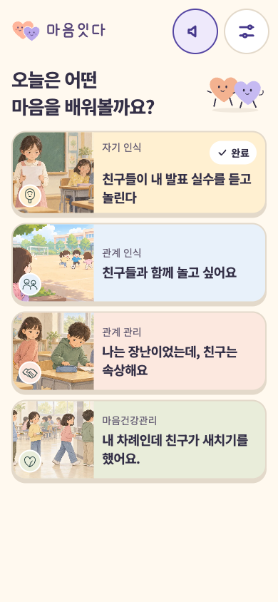
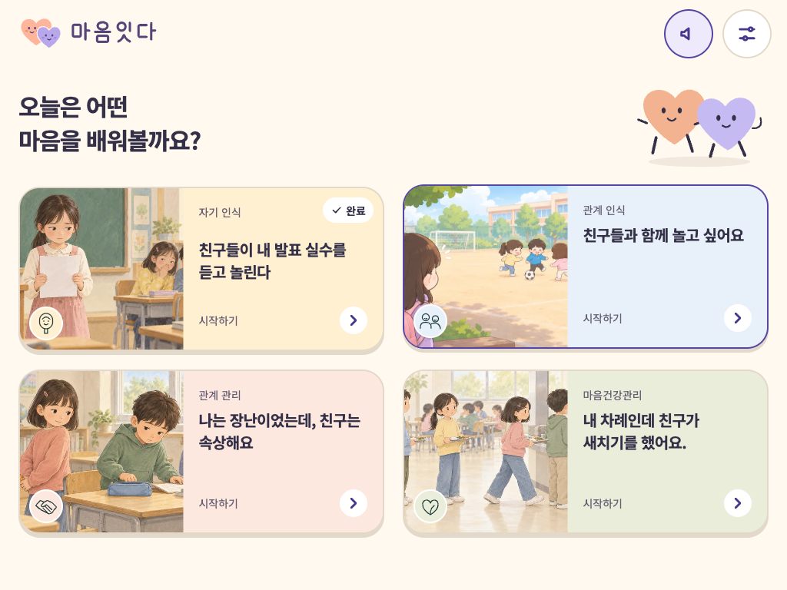
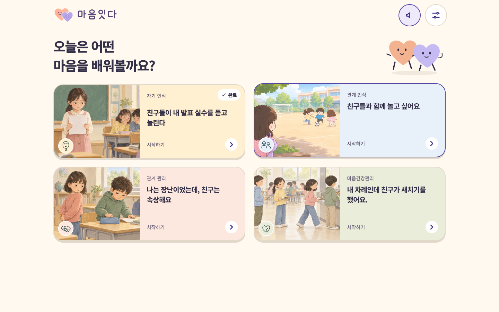

<strong>상황 보기 화면 — 스마트폰 · 태블릿 · PC</strong>

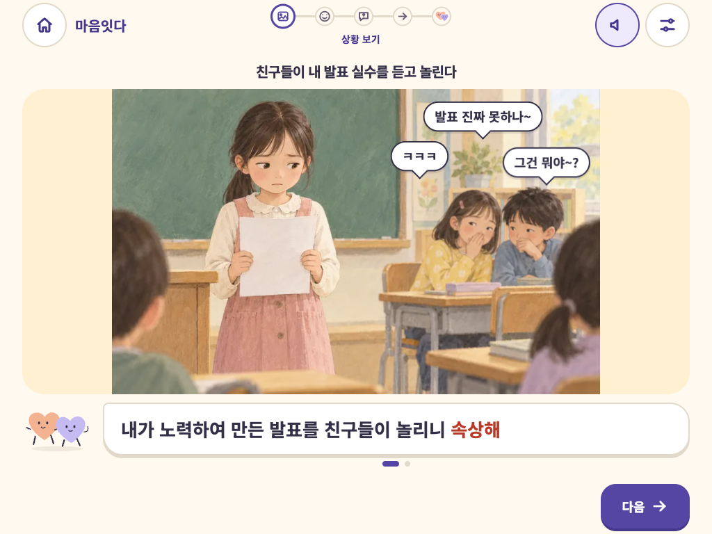
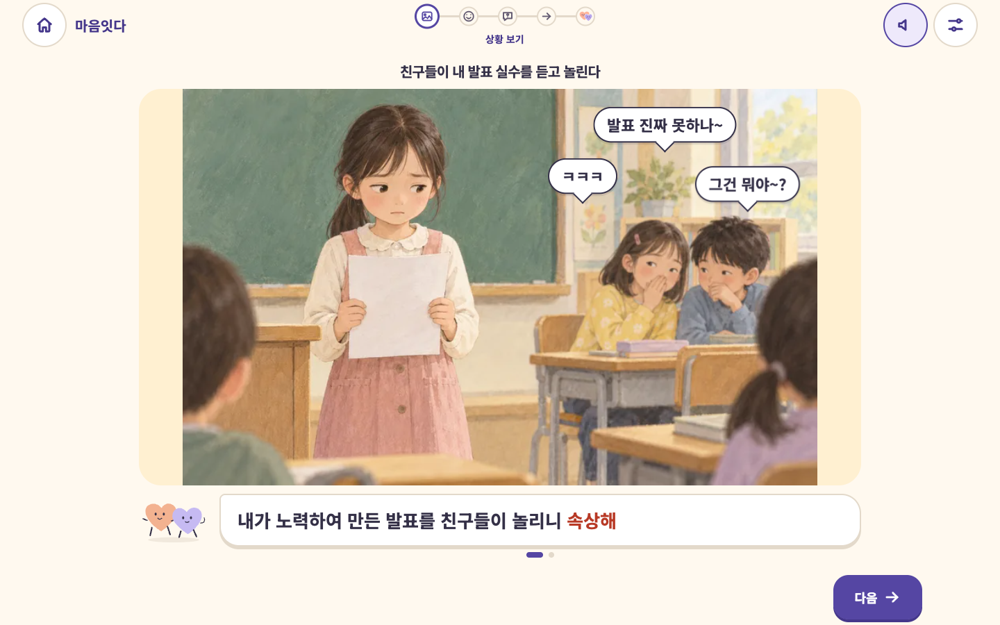

---

## 3. 핵심 기능

- **4개 사회정서영역, 4개 상황**: 자기 인식 · 관계 인식 · 관계 관리 · 마음건강관리. 각 영역 콘텐츠 설계서의 문구를 원문 그대로 사용했습니다.
- **5단계 학습 흐름**: 상황 보기 → 감정 알아보기 → 이유·몸의 반응 → 대처방법 선택 → 선택에 따른 피드백 → 마무리.
- **한국어 음성 읽어주기**: 모든 화면 문장(128개)을 AI 성우 음성으로 녹음해 앱에 내장했습니다. 화면이 바뀌면 자동으로 읽어 주고, 스피커 버튼으로 켜고 끌 수 있습니다.
- **느린학습자 배려**: 한 번에 한 문장, 큰 버튼, 글자 크기 조절, 힌트 제공, 정답/오답이 없는 설명형 피드백, 다른 방법 다시 해보기.
- **오프라인 사용**: 한 번 접속하면 그림과 음성까지 저장되어 인터넷 없이도 사용할 수 있습니다.
- **학습 기록**: 완료한 상황은 홈 화면에 "완료"로 표시됩니다. 기록은 사용 기기 안에만 남습니다.

---

## 4. 화면 흐름 (스마트폰 화면, 자기 인식 상황 예시)

### 4-1. 시작 · 홈

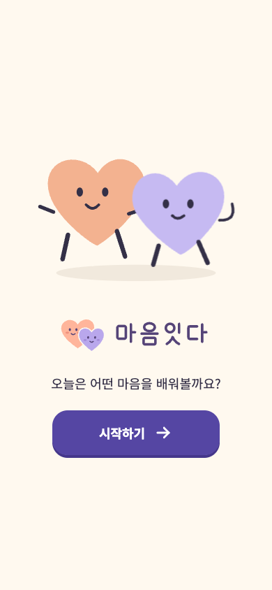
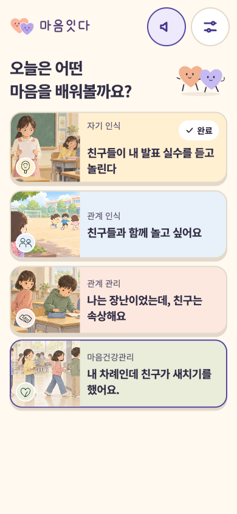

첫 접속 시 **시작하기**를 한 번 누르면 음성 재생이 준비됩니다. 홈에서는 4개 영역의 상황 카드 중 하나를 골라 시작합니다. 오른쪽 위 스피커는 음성 켜기/끄기, 옆 아이콘은 설정입니다.

### 4-2. STEP 1 상황 보기

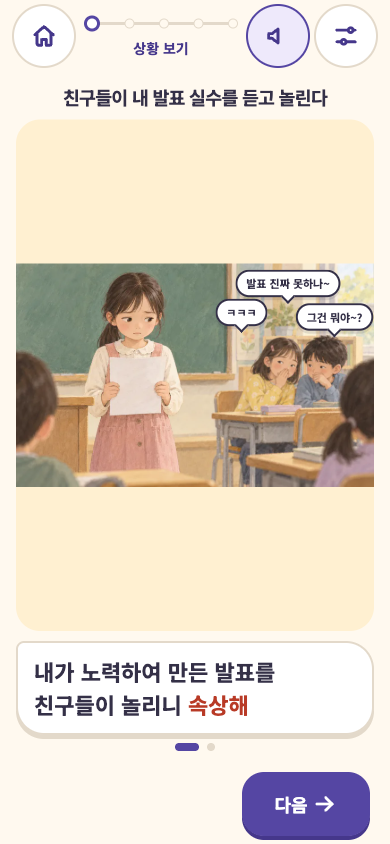

그림과 말풍선으로 상황을 보여 주고, 이야기를 **한 문장씩** 읽어 줍니다. 설계서의 강조 단어(속상해)는 빨간색으로 표시됩니다. 위쪽 진행 표시로 현재 단계를 알 수 있습니다.

### 4-3. STEP 2 감정 알아보기

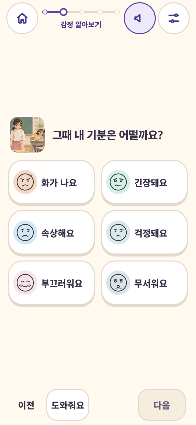
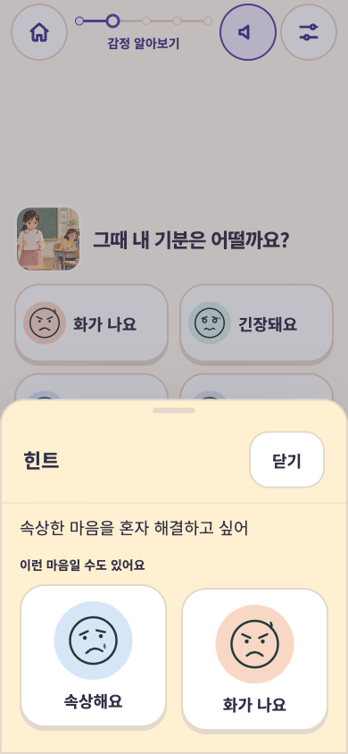

감정 단어와 표정 아이콘을 함께 보여 줍니다. 감정을 고르면 **다음** 버튼이 켜지며, 정답·오답은 없습니다.
**도와줘요**를 누르거나 20초 동안 고르지 못하면 힌트가 열려 핵심 문장과 설계서가 제안한 감정 2개를 보여 줍니다. "잘 모르겠어요"를 두 번 고르면 앱이 제안 감정을 대신 골라 줍니다.

### 4-4. STEP 3 이유 생각하기 · 몸의 반응

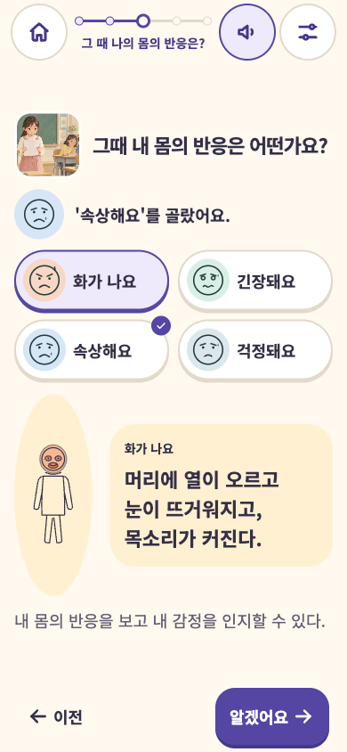
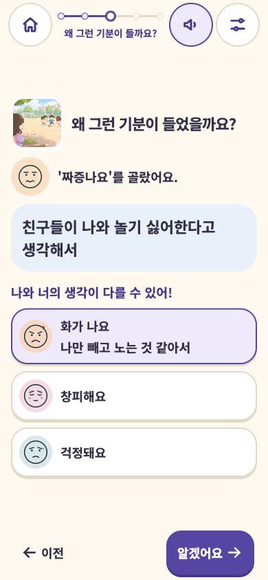

자기 인식 영역(왼쪽)에서는 감정 버튼을 누를 때마다 **몸의 반응**을 그림과 문장으로 보여 줍니다.
관계 인식·마음건강관리 영역(오른쪽)에서는 내가 고른 이유를 먼저 인정한 뒤, 다른 감정의 이유도 열어 보며 **"나와 너의 생각이 다를 수 있어!"**를 경험합니다. 관계 관리 영역은 A~D 선택형이며, 고른 뒤 핵심 피드백이 나타납니다.

### 4-5. STEP 4 대처방법 선택 · STEP 5 피드백

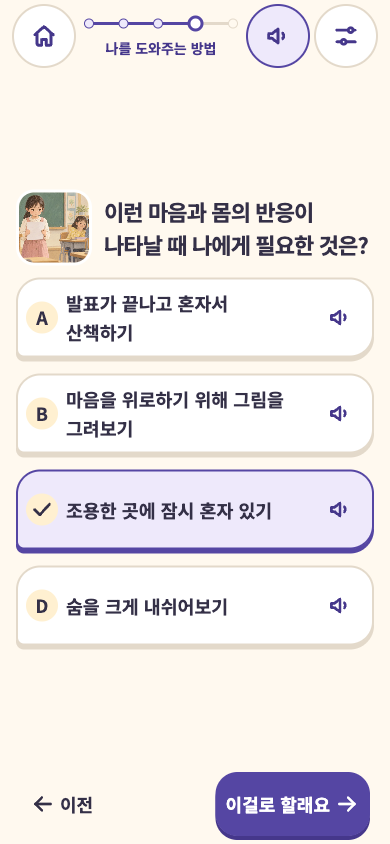
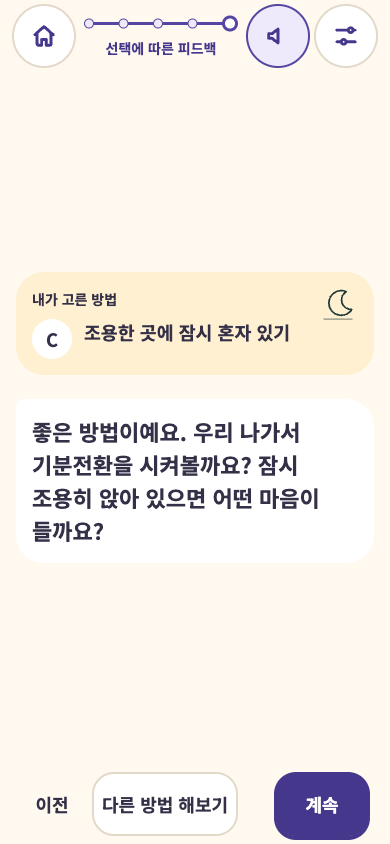

A~D 네 가지 방법 중 하나를 고르고 **이걸로 할래요**를 누릅니다. 각 카드의 스피커로 문장을 다시 들을 수 있습니다.
피드백 화면은 고른 방법과 결과 아이콘을 보여 주고 설계서의 피드백 문장을 읽어 줍니다. "틀렸어요" 대신 결과를 설명하며, **다른 방법 해보기**로 돌아가 다시 고를 수 있습니다.

### 4-6. 마무리 · 설정

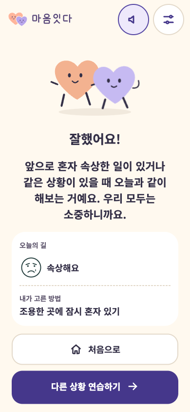
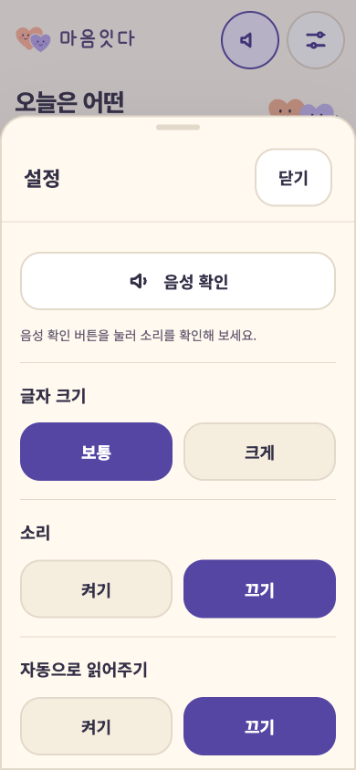

마무리 화면은 마무리 메시지와 함께 오늘 고른 감정과 방법을 요약하고, **처음으로** 또는 **다른 상황 연습하기**로 반복 학습합니다.
설정에서는 음성 확인 · 글자 크기(보통/크게) · 효과음 · 자동으로 읽어주기를 조절합니다.

---

## 5. 콘텐츠 구성

| 영역 | 상황 | STEP 3 방식 | 대처방법 |
| --- | --- | --- | --- |
| 자기 인식 | 친구들이 내 발표 실수를 듣고 놀린다 | 감정별 몸의 반응 탐색 | A~D 모두 탐색 가능 |
| 관계 인식 | 친구들과 함께 놀고 싶어요 | 감정별 이유 + 다른 감정의 이유 비교 | A는 다시 생각, C 권장 |
| 관계 관리 | 나는 장난이었는데, 친구는 속상해요 | A~D 선택 후 핵심 피드백 | A·B는 다시 생각, C·D 권장 |
| 마음건강관리 | 내 차례인데 친구가 새치기를 했어요 | 감정별 이유 비교 | A~D 모두 탐색 가능 |

- 감정 단어 15개(화가 나요 · 짜증나요 · 속상해요 · 서운해요 · 답답해요 · 억울해요 · 걱정돼요 · 긴장돼요 · 창피해요 · 당황스러워요 · 부끄러워요 · 무서워요 · 미안해요 · 재미있어요 · 잘 모르겠어요)와 전용 표정 아이콘을 제공합니다.
- 모든 문구는 네 영역 콘텐츠 설계서 원문과 대조해 확인했습니다. 원문의 표기(예: 새채기, 연칠)도 그대로 두었으니, 고칠 문구가 있으면 알려 주시면 반영하겠습니다.

---

## 6. 설치와 운영

- **설치**: 주소로 접속한 뒤 iPad·iPhone은 Safari 공유 버튼 → "홈 화면에 추가", Android·PC Chrome은 메뉴 → "앱 설치"를 누르면 아이콘이 생깁니다. 이후 인터넷 없이도 실행됩니다.
- **서버 없음**: 별도 서버나 데이터베이스가 없어 운영 비용과 관리 부담이 없습니다. 설정과 학습 진행은 기기 안에만 저장되며 외부로 전송되지 않습니다.
- **음성**: 녹음된 음성 파일이 앱에 포함되어 있어 재생에 추가 비용이나 통신이 필요 없습니다.
- **콘텐츠 수정·추가**: 문구 수정이나 새 상황 추가는 설계서 형식으로 전달해 주시면 반영 후 같은 주소로 배포됩니다. 새 문장은 음성도 함께 녹음해 추가합니다.

---

## 7. 품질 확인

| 항목 | 결과 |
| --- | --- |
| 학습 흐름·힌트·음성 자동 테스트 | 통과 |
| 콘텐츠 원문 대조 | 4개 영역 모두 설계서와 일치 |
| 브라우저 | Chrome · Safari(WebKit) 계열에서 동작 확인, 접근성 검사 포함 |
| 화면 크기 | 스마트폰·태블릿·PC 11가지 크기, 보통/큰 글자에서 확인 |
| 실제 기기 | Mac Chrome에서 음성·자동 읽기 확인. 학교 iPad·Android 태블릿 확인은 인수 후 함께 진행 권장 |

---

## 8. 전달 자료

- 서비스 주소: https://maumlink.vercel.app

